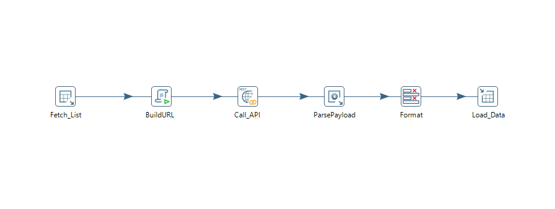

# Real-Time-Nepal-Weather-Data-Integration-Pipeline-and-Analytics
# 🇳🇵 Real-Time Nepal Weather Analytics Dashboard

> An end-to-end weather analytics project that automates real-time weather data collection, stores historical records in MySQL, and visualizes actionable insights through an interactive Power BI dashboard.

---

## 📌 Project Overview

The **Real-Time Nepal Weather Analytics Dashboard** collects live weather data from the **OpenWeatherMap API** for over **145 Nepalese cities**, processes and stores the data in **MySQL**, and presents meaningful insights through **Power BI**.

The dashboard enables users to compare weather conditions across cities, monitor temperature, humidity, wind speed, and weather conditions, supporting informed decision-making for travel, logistics, agriculture, and weather monitoring.

---

## 🎯 Objectives

- Automate real-time weather data collection
- Store historical weather records for analysis
- Compare weather conditions across Nepalese cities
- Build an interactive business intelligence dashboard
- Generate meaningful insights from raw weather data

---

## 💡 Business Value

This dashboard transforms raw weather data into actionable insights by enabling users to:

- Compare weather across multiple Nepalese cities
- Identify temperature and humidity variations
- Monitor changing weather conditions
- Support travel planning
- Assist logistics operations
- Aid agriculture monitoring
- Improve weather awareness through interactive analytics

---

### Executive Dashboard

<p align="center">

</p>

## 🗃 Database Schema

weather_data

- city
- latitude
- longitude
- temperature
- humidity
- wind_speed
- weather_main
- weather_description
- fetched_at

```
Weather-Analytics-Dashboard/
│
├── data/
├── pentaho_jobs/
├── sql/
├── powerbi/
├── images/
└──  README.md
```
